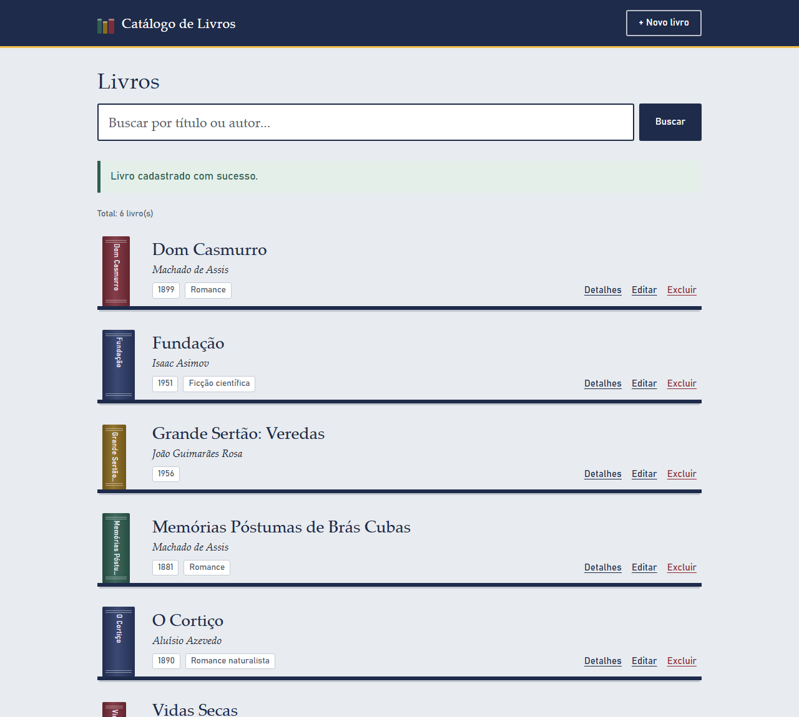
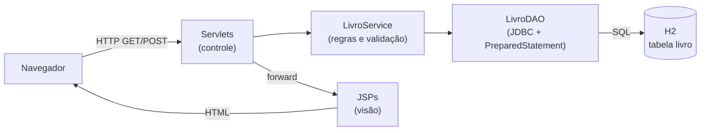
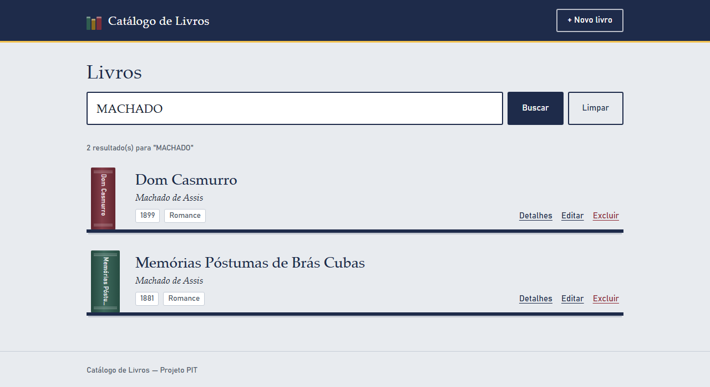
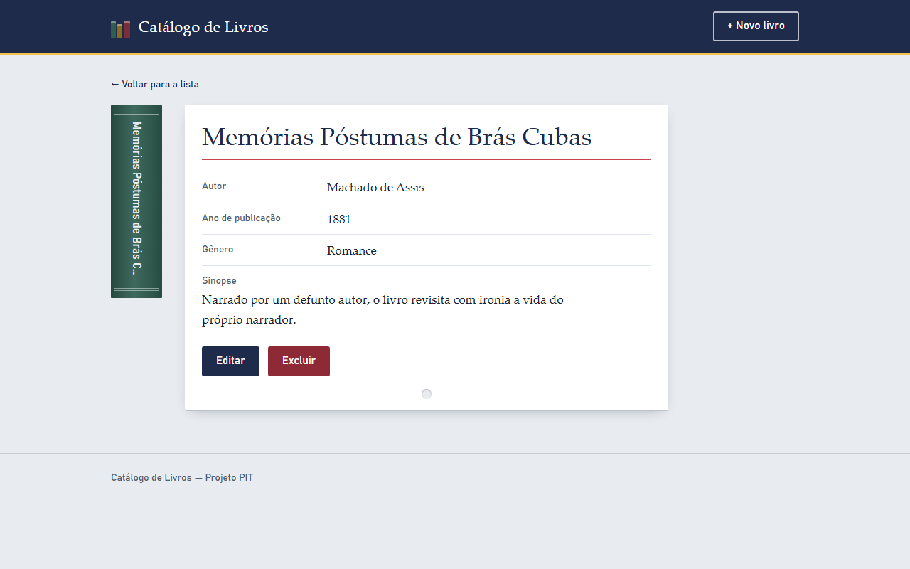
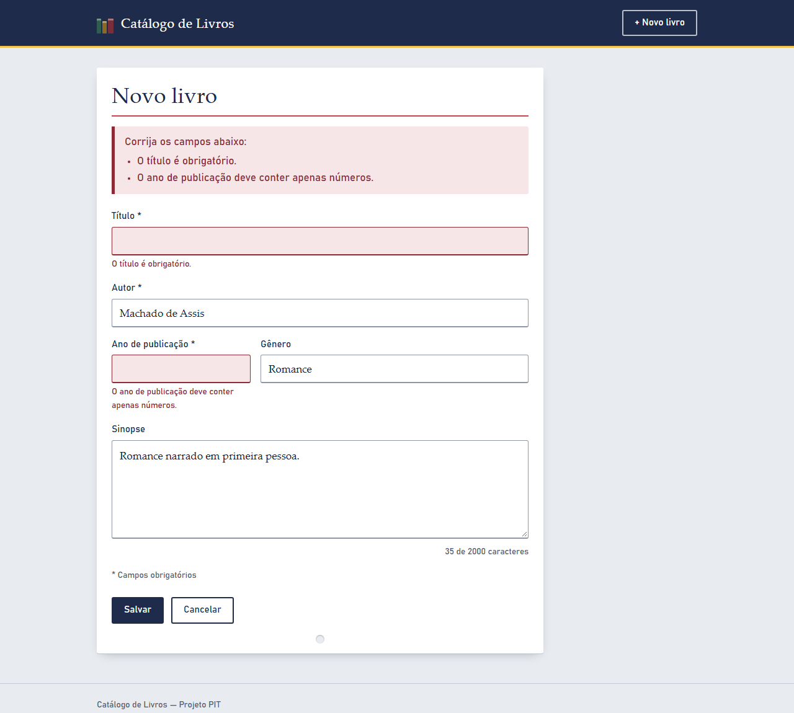
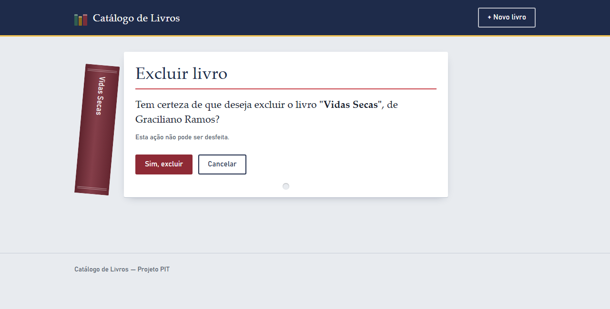

# Catálogo de Livros

Aplicação web para **cadastrar, consultar e organizar livros**, desenvolvida em Java com
Servlets, JSP e JDBC puros, sem frameworks. Projeto Integrador Transdisciplinar (PIT) em
Ciência da Computação.



---

## Funcionalidades

- **Cadastrar** livros com título, autor, ano de publicação, gênero e sinopse
- **Listar** o acervo em ordem alfabética, como uma estante
- **Buscar** por parte do título ou do autor (sem diferenciar maiúsculas de minúsculas)
- **Ver detalhes** de cada livro em uma ficha catalográfica
- **Editar** e **excluir** (com página de confirmação)
- **Persistência** em banco de dados relacional (H2)
- Interface **responsiva**, que funciona no celular e no computador

Como não há imagem de capa, cada livro ganha uma **lombada** desenhada só com CSS. A cor vem do
id do livro, então o mesmo livro tem sempre a mesma cor.

## Tecnologias

| | |
|---|---|
| Linguagem | Java 17 |
| Web | Jakarta Servlet 6.0 · JSP · EL · JSTL 3.0 |
| Banco de dados | JDBC + H2 2.2 (modo arquivo) |
| Servidor | Eclipse Jetty 12 (`jetty-ee10-maven-plugin`) |
| Build | Apache Maven (empacotamento `war`) |
| Interface | HTML5 + CSS3 próprios, sem bibliotecas externas |

## Como executar

**Pré-requisitos:** JDK 17 ou superior e Maven 3.9 ou superior.

```bash
mvn jetty:run
```

Depois, abra **http://localhost:8080**. Não é preciso instalar banco nem servidor: o Maven
baixa o Jetty e o H2 na primeira execução, e a tabela é criada automaticamente na subida.

- Os dados ficam em `dados/catalogo.mv.db`. Para começar do zero, desligue o servidor e apague
  a pasta `dados/`.
- Para parar o servidor, pressione `Ctrl + C` no terminal.

## Arquitetura



Cada camada tem uma única responsabilidade:

- **Servlets:** recebem a requisição e escolhem a resposta.
- **Service:** valida e aplica as regras.
- **DAO:** é o único lugar com SQL.
- **JSPs:** só exibem os dados.

As JSPs ficam dentro de `WEB-INF`, então toda tela passa obrigatoriamente por um Servlet.

| URL | Método | Ação |
|---|---|---|
| `/livros` | GET | Lista os livros ou busca (`?busca=termo`) |
| `/livros/novo` | GET / POST | Formulário de cadastro / grava |
| `/livros/detalhes?id=` | GET | Detalhes de um livro |
| `/livros/editar` | GET / POST | Formulário preenchido / grava |
| `/livros/excluir` | GET / POST | Confirmação / exclui |

## Segurança

- **SQL Injection:** `PreparedStatement` em todas as consultas, inclusive na busca com
  `LIKE`. Os caracteres `%` e `_` digitados são tratados como texto comum.
- **XSS:** toda saída de dados nas JSPs passa por `<c:out>`.
- **Validação no servidor:** campos obrigatórios, ano numérico e dentro de uma faixa, e
  tamanhos máximos iguais aos das colunas do banco.
- **Exceções:** `try-catch-finally` no acesso ao banco, com mensagens amigáveis. Páginas de
  erro próprias evitam que o usuário veja stack trace ou detalhes do servidor.
- **Outros:**
  - excluir só é possível por POST, depois de confirmar;
  - ids inválidos na URL são tratados;
  - a sessão é rastreada só por cookie (sem `;jsessionid` nos links).

## Estrutura do projeto

```
src/main/java/br/edu/catalogo/
├── model/      Livro                         (entidade)
├── servlet/    Listar, Cadastrar, Detalhes,  (controle)
│               Editar e ExcluirLivroServlet
├── service/    LivroService                  (regras e validação)
│               ValidacaoException
├── dao/        LivroDAO, DAOException        (acesso ao banco)
└── util/       FabricaDeConexoes, InicializadorBanco, Parametros
src/main/resources/sql/script.sql             (criação da tabela)
src/main/webapp/
├── WEB-INF/jsp/   telas (lista, formulário, detalhes, exclusão, erro)
├── WEB-INF/web.xml
└── css/estilo.css
docs/                                         (documentação do projeto)
```

## Telas

| Busca | Detalhes |
|---|---|
|  |  |
| **Validação por campo** | **Confirmação de exclusão** |
|  |  |

## Documentação

| Documento | Conteúdo |
|---|---|
| [Manual do usuário](docs/manual-do-usuario.md) | Como instalar e usar |

O Javadoc pode ser gerado com `mvn javadoc:javadoc`; o resultado fica em
`target/reports/apidocs/index.html`.

## Autor

**William Rios Pereira**: Projeto Integrador Transdisciplinar (PIT), Ciência da Computação, 2026.
