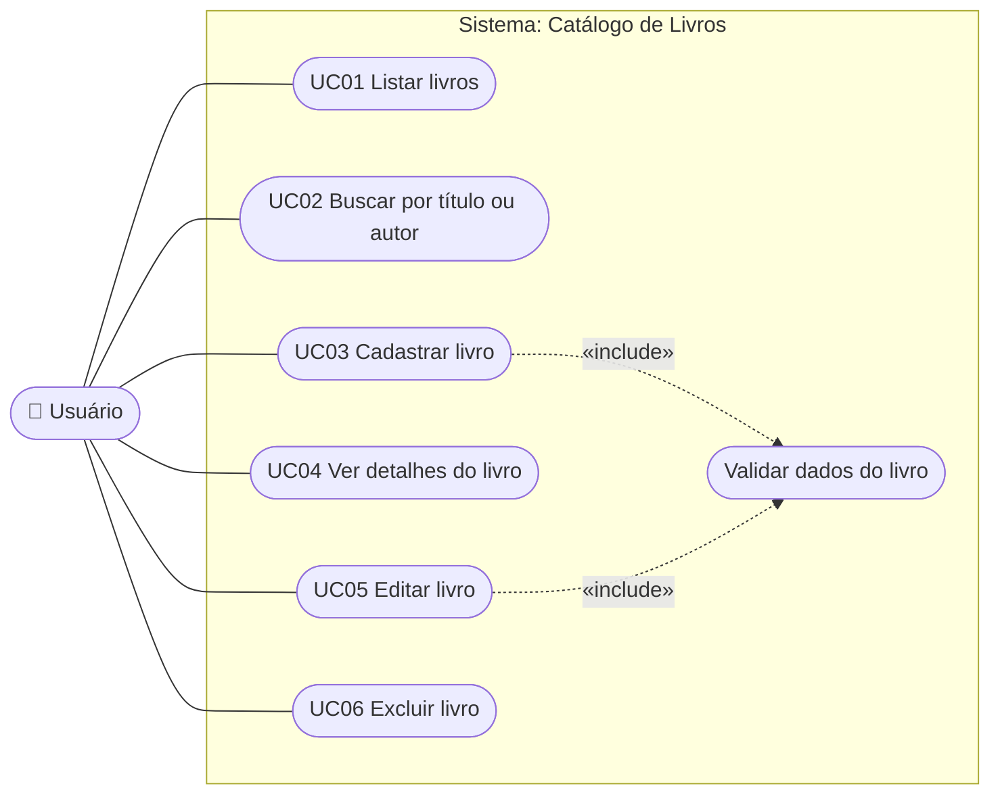
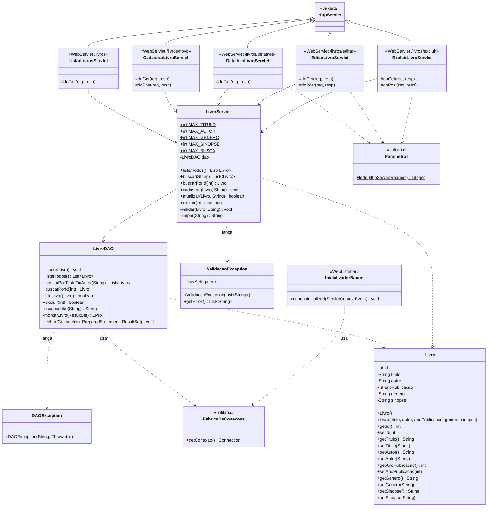
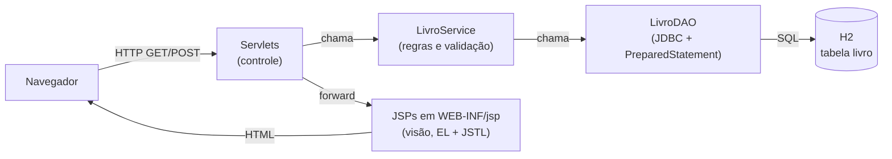
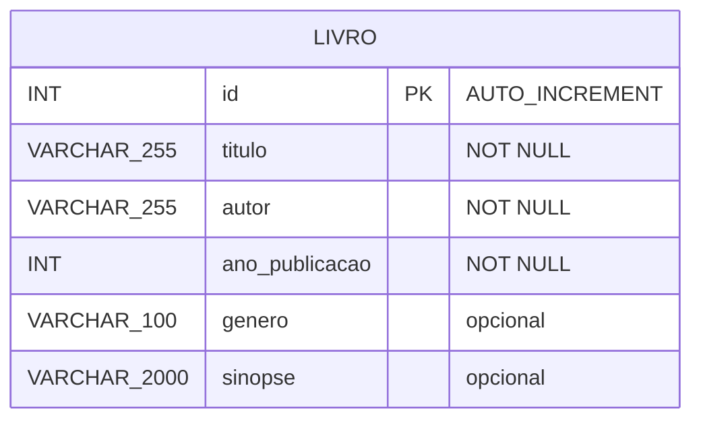

# Modelagem do Sistema — Catálogo de Livros

> Diagramas fiéis ao código em `src/main/java/br/edu/catalogo`. Estão em **Mermaid**, que o
> GitHub, o VS Code (com extensão) e o site https://mermaid.live desenham automaticamente.
> Para o relatório em PDF, gere uma imagem de cada diagrama no mermaid.live e cole no documento.

---

## 1. Diagrama de Casos de Uso

O Mermaid não tem um tipo próprio para casos de uso da UML. Por isso, o diagrama abaixo usa
a notação mais próxima: o ator à esquerda, os casos de uso em formato oval e a fronteira do
sistema como um retângulo. Se o tutor exigir a notação UML exata, redesenhe no draw.io ou
no Astah com os mesmos elementos.



| Caso de uso | Descrição | Classe responsável |
|---|---|---|
| UC01 Listar livros | Mostra todos os livros em ordem alfabética de título | `ListarLivrosServlet` |
| UC02 Buscar | Filtra por parte do título **ou** do autor (SQL `LIKE`) | `ListarLivrosServlet` (parâmetro `busca`) |
| UC03 Cadastrar | Formulário de novo livro, validado no servidor | `CadastrarLivroServlet` |
| UC04 Ver detalhes | Mostra todos os campos de um livro | `DetalhesLivroServlet` |
| UC05 Editar | Formulário preenchido, validado no servidor | `EditarLivroServlet` |
| UC06 Excluir | Pede confirmação (GET) e exclui (POST) | `ExcluirLivroServlet` |
| Validar dados | Obrigatórios, ano numérico, tamanhos máximos | `LivroService.validar()` |

Há um único ator, o **Usuário**: o sistema não tem login, então qualquer pessoa que acessa a
aplicação pode usar todas as funções.

---

## 2. Diagrama de Classes



**Como ler:** `-` é privado, `+` é público, `#` é protegido e `$` indica membro estático.
A seta cheia (`-->`) é associação ("tem um"), a tracejada (`..>`) é dependência ("usa") e o
triângulo (`<|--`) é herança. Os servlets herdam de `HttpServlet` e sobrescrevem `doGet`/`doPost`
(polimorfismo por sobrescrita).

**Camadas:**



---

## 3. Diagrama Entidade-Relacionamento (DER)

O sistema tem uma única entidade, então não há relacionamentos entre tabelas.



| Coluna | Tipo | Restrição | Atributo Java | Validação no servidor (`LivroService`) |
|---|---|---|---|---|
| `id` | `INT` | `PRIMARY KEY AUTO_INCREMENT` | `id` | gerado pelo banco |
| `titulo` | `VARCHAR(255)` | `NOT NULL` | `titulo` | obrigatório, até 255 |
| `autor` | `VARCHAR(255)` | `NOT NULL` | `autor` | obrigatório, até 255 |
| `ano_publicacao` | `INT` | `NOT NULL` | `anoPublicacao` | obrigatório, numérico, de 1 até o ano atual + 5 |
| `genero` | `VARCHAR(100)` | — | `genero` | opcional, até 100 |
| `sinopse` | `VARCHAR(2000)` | — | `sinopse` | opcional, até 2000 |

Diferenças em relação ao exemplo do enunciado (tabela `item_midia`, folha 22):

- não há `tipo_midia`, porque o catálogo é só de livros;
- `autor_diretor` virou `autor` e `ano_lancamento` virou `ano_publicacao`;
- `sinopse` é `VARCHAR(2000)` em vez de `TEXT`, para o banco também impor o tamanho máximo;
- `autor` e `ano_publicacao` são `NOT NULL`, coerentes com a validação.

---

## 4. Script SQL de criação da tabela

Arquivo `src/main/resources/sql/script.sql`, executado automaticamente pela classe
`InicializadorBanco` sempre que a aplicação sobe:

```sql
-- Tabela principal do catalogo: guarda os livros
-- (executado pelo InicializadorBanco sempre que a aplicacao sobe;
--  IF NOT EXISTS evita erro quando a tabela ja existe)
CREATE TABLE IF NOT EXISTS livro (
    id             INT AUTO_INCREMENT PRIMARY KEY,
    titulo         VARCHAR(255)  NOT NULL,
    autor          VARCHAR(255)  NOT NULL,
    ano_publicacao INT           NOT NULL,
    genero         VARCHAR(100),
    sinopse        VARCHAR(2000)
);
```

Banco: **H2 2.2.224** em modo arquivo (`jdbc:h2:file:./dados/catalogo`). O arquivo
`dados/catalogo.mv.db` é criado na pasta onde o `mvn jetty:run` é executado.
